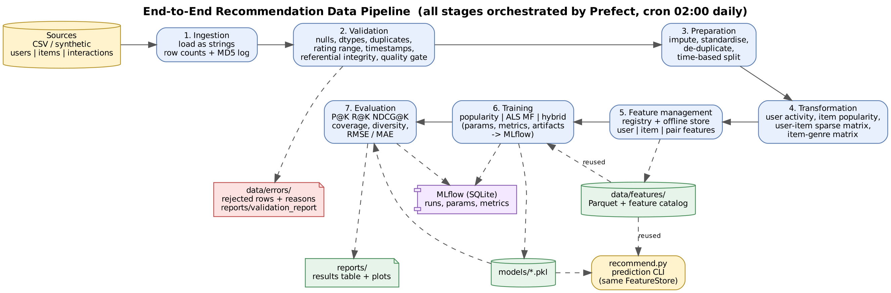
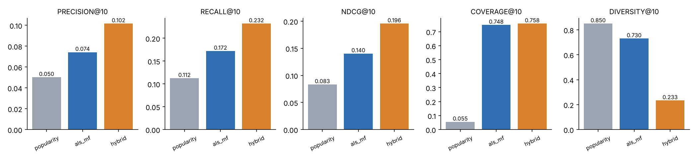

# End-to-End Data Management Pipeline for a Recommendation System

DM4ML Assignment 2. A modular, reproducible pipeline for a (synthetic) movie platform:

`Ingestion -> Validation -> Preparation -> Transformation -> Feature Management -> Training -> Evaluation -> Orchestration`



## 1. Setup

```bash
python -m venv .venv && source .venv/bin/activate      # Windows: .venv\Scripts\activate
pip install -r requirements.txt
```
Python 3.12 was used. Graphviz is only needed to regenerate the diagrams.

## 2. Run the full pipeline (one command)

```bash
python run_pipeline.py                  # runs the Prefect flow (ingest -> ... -> report), ~20 s
python run_pipeline.py --no-prefect     # same stages, plain Python, no Prefect
python run_pipeline.py --config configs/config.yaml
```
Everything is driven by `configs/config.yaml` (+ fixed seed) so runs are reproducible. Two consecutive runs
produce identical metrics (verified).

Other commands:
```bash
pytest -q                                              # unit tests (validation rules, metrics, split)
python recommend.py --user 42 --model hybrid --k 10    # prediction using trained model + FeatureStore
mlflow ui --backend-store-uri sqlite:///mlflow.db      # browse params / metrics / artifacts at :5000
prefect server start                                   # Prefect UI at :4200 (then run the flow again)
python dags/recommendation_flow.py --serve             # schedule the flow daily at 02:00 (cron)
python scripts/make_architecture.py                    # regenerate reports/architecture.png
```

## 2b. Running on Kaggle
`DM4ML_Assignment2_Kaggle.ipynb` contains the same project as a single notebook. It writes the modules into
`/kaggle/working/recommendation-pipeline`, installs mlflow and prefect (Internet must be enabled for the session),
runs the tests and the pipeline, and shows the reports. If Prefect cannot start, the notebook runs the same stages
with `--no-prefect`.

## 3. Data
`src/ingestion/synthetic.py` generates 1,500 users, 600 items (10 genres) and ~51k interactions (ratings 1-5, 2 years
of timestamps) with built-in taste structure (genre preference + latent factors + popularity skew). It then **injects
realistic data-quality problems** (missing values, duplicates, wrong dtypes, ratings of 0/6/99, malformed and future
timestamps, orphan user/item ids, interactions before signup) so validation has real work to do.
To use your own data set `data.source: csv` and put `users.csv`, `items.csv`, `interactions.csv` in `data.csv_dir`
(columns: `user_id,age,gender,country,signup_date` / `item_id,title,category,release_year` /
`user_id,item_id,rating,timestamp` - category is `genre1|genre2`).

## 4. Stages and outputs

| Stage | Code | Output |
|---|---|---|
| Ingestion | `src/ingestion/` | `data/raw/*.csv`, `reports/ingestion_log.json` (row counts, MD5) |
| Validation | `src/validation/validate.py` | `data/errors/*_errors.csv`, `reports/validation_report.md/json`, `reports/pipeline.log` |
| Preparation | `src/preparation/prepare.py` | `data/processed/{users,items,interactions}_clean, train, test.parquet` (time-based split) |
| Transformation | `src/transformation/transform.py` | user activity summary, item popularity, item-genre matrix, sparse user-item matrix |
| Feature mgmt | `src/features/` | `data/features/*.parquet`, `reports/feature_catalog.md/csv` |
| Training | `src/training/` | `models/*.pkl`, MLflow runs (`mlflow.db`, `mlruns/`), `reports/mlflow_runs_summary.csv` (portable export of all params + metrics) |
| Evaluation | `src/evaluation/` | `reports/evaluation_results.md/csv/json`, `reports/model_comparison.png` |
| Orchestration | `dags/recommendation_flow.py` | Prefect flow, `reports/orchestration_run.png`, `reports/run_log.jsonl` |

**Validation design.** Checks are `error` (row rejected to the error dataset with reasons) or `warning` (row kept,
repaired in preparation, e.g. impute missing age). A quality gate fails the pipeline if > 15% of any table is rejected.

**Split.** Time-based: the last 20% of the interaction timeline is the test set (no random shuffling, no leakage).
Features, popularity and models only see the training period.

**Models.** (1) `popularity` baseline; (2) `als_mf` - implicit-feedback ALS matrix factorisation for ranking + explicit
biased MF for rating prediction (NumPy implementation); (3) `hybrid` - CF score + content (category-affinity feature) +
popularity prior; blend weights tuned on a time-based validation slice of the *training* data.

**Evaluation.** Precision@K, Recall@K, NDCG@K, Coverage, Diversity for K=5 and 10; RMSE/MAE for rating predictors.
Warm-start users with >=1 relevant (rating>=4) test item; train-seen items are excluded from recommendations.

## 5. Results (K = 10)
See `reports/evaluation_results.md` for the complete table (also K = 5, RMSE/MAE).



## 6. Orchestration evidence
`reports/orchestration_run.png` is rendered from `reports/run_log.jsonl` (status + duration of each Prefect task) after a
successful run. `reports/orchestration_failed_gate_demo.png` shows the DAG stopping at `validate` when the quality gate is
tightened (downstream tasks never start). For a Prefect-UI screenshot run `prefect server start`, then
`python run_pipeline.py`, and open http://127.0.0.1:4200 .

## 7. Project structure
```
configs/config.yaml   dags/recommendation_flow.py   run_pipeline.py   recommend.py
src/{ingestion,validation,preparation,transformation,features,training,evaluation}/
data/{raw,processed,features,errors}/   models/   reports/   scripts/   tests/
```
